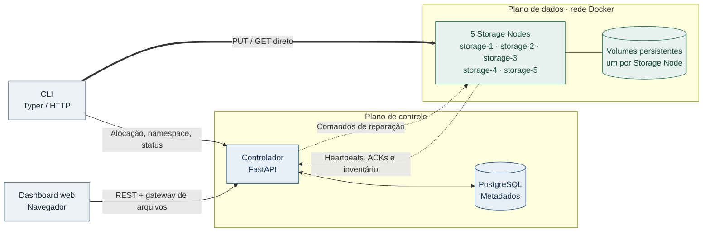
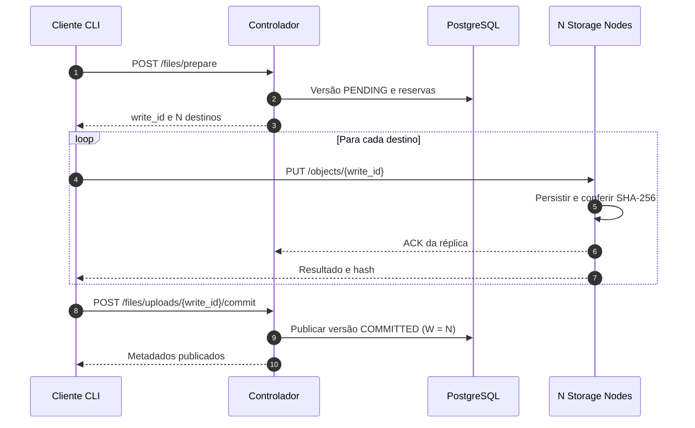

# DComp Drive

**Armazenamento distribuído de arquivos com replicação, integridade e recuperação automática.**

[](https://www.python.org/)
[](https://fastapi.tiangolo.com/)
[](https://www.postgresql.org/)
[](https://docs.docker.com/compose/)

Projeto da disciplina **Sistemas Distribuídos (COMP0470)** da Universidade Federal de Sergipe. Desenvolvido para estudar replicação de dados, detecção de falhas, consistência, recuperação e separação dos planos de controle e de dados.

[**Instalação**](#inicialização) · [**Arquitetura**](#arquitetura) · [**Comandos**](#operações-com-arquivos) · [**Interface web**](#interface-web) · [**Testes**](#testes-e-evidências) · [**Documentação**](#documentação)

---

## Visão geral

| Componente | Ambiente da Parte 1 | Função |
| :--- | :--- | :--- |
| Controlador | 1 serviço FastAPI | Namespace, versões, alocação e reparação |
| Metadados | PostgreSQL 17 | Persistência transacional |
| Armazenamento | 5 Storage Nodes | Objetos e réplicas em volumes separados |
| Clientes | CLI e dashboard web | Operações de arquivo e visualização |
| Replicação | N configurável; padrão 3 | Cópias em nós e discos lógicos distintos |

Um arquivo só é publicado após a confirmação das `N` réplicas exigidas. Em caso de falha, o controlador localiza uma cópia íntegra e recompõe o número de réplicas em outros nós elegíveis. O sistema também detecta corrupção por SHA-256, na leitura e em verificações periódicas (*scrubbing*).

### Recursos implementados

| Área | Comportamento |
| :--- | :--- |
| Arquivos | `put`, `get`, `ls`, `mkdir`, `rmdir`, `mv`, `rm` e `stat` |
| Integridade | SHA-256 na escrita, leitura e scrubbing |
| Tolerância a falhas | Heartbeats, estados de nós e re-replicação automática |
| Descoberta | Registro e reconciliação após retorno de nó |
| Capacidade | Seleção por espaço livre, limite de uso e `drain` |
| Concorrência | Versões pendentes; publicação com `W = N` confirmações |
| Segurança dos dados | AES-256-GCM opcional, configurado nos Storage Nodes |
| Observabilidade | `/status`, `/metrics` e logs estruturados |

## Arquitetura

O cliente Docker (`client`) separa controle e transferência de arquivos. Ele solicita ao controlador a localização das réplicas e transmite o conteúdo diretamente aos Storage Nodes. O dashboard é uma interface de conveniência: seu upload e download passam pelo gateway HTTP do controlador.



**Plano de controle:** diretórios, versões, hash esperado, alocação, estados de nós, capacidade e tarefas de recuperação. **Plano de dados:** escrita, leitura e cópia dos objetos entre os nós. Cada Storage Node dispõe de um volume Docker independente.

> **Escopo do ambiente:** os cinco storages são contêineres na **mesma instância EC2**, não máquinas físicas independentes. O laboratório demonstra falhas de nós lógicos; não demonstra resistência à perda do host inteiro.

### Protocolo de gravação



O controlador recusa a publicação se não houver confirmações suficientes. Leituras consultam apenas versões publicadas e conferem o SHA-256 do conteúdo recebido. Esse modelo prioriza consistência de escrita sobre disponibilidade de novas gravações quando não é possível alcançar `W = N`.

## Inicialização

**Requisitos:** Git, Docker Engine e Docker Compose v2. Os comandos abaixo usam Linux ou macOS; no Ubuntu, acrescente `sudo` aos comandos Docker caso necessário.

### 1. Obter e configurar

```bash
git clone https://github.com/thejosephantony/Dcomp-Drive.git
cd Dcomp-Drive
cp .env.example .env
mkdir -p demo-files
```

Edite `.env` e substitua `POSTGRES_PASSWORD` por uma senha privada. A configuração inicial usa `REPLICATION_FACTOR=3` e `ENCRYPTION_ENABLED=false`.

### 2. Iniciar os serviços

```bash
docker compose config --quiet
docker compose up -d --build
docker compose ps
```

O Compose inicializa PostgreSQL, controlador e cinco storages. A primeira execução pode demorar por causa das migrações do banco. Espere o controlador responder:

```bash
curl -fsS http://127.0.0.1:8000/health
curl -fsS http://127.0.0.1:8000/status | python3 -m json.tool
```

A resposta de `/health` deve conter `{"status":"ok"}`. Para acompanhar a inicialização:

```bash
docker compose logs -f controller
```

**Persistência:** os volumes preservam banco e objetos entre reinicializações. Não execute `docker compose down -v` em um ambiente com dados que precisam ser mantidos.

## Operações com arquivos

O cliente principal é executado com `docker compose run --rm client`. Esse serviço usa o backend HTTP e `DCOMP_DIRECT_STORAGE=true`, acessando o controlador e os storages pela rede interna do Compose.

A pasta local `demo-files/` é montada no cliente como `/work`.

### Exemplo completo

```bash
# Preparar o arquivo de demonstração no host
printf 'Arquivo de demonstração do DComp Drive.\n' > demo-files/exemplo.txt

# Criar diretório e enviar
docker compose run --rm client mkdir /documentos
docker compose run --rm client put /work/exemplo.txt /documentos/exemplo.txt

# Consultar diretório e metadados
docker compose run --rm client ls /documentos
docker compose run --rm client stat /documentos/exemplo.txt

# Baixar e comparar o conteúdo
docker compose run --rm client get /documentos/exemplo.txt /work/recuperado.txt
sudo cmp demo-files/exemplo.txt demo-files/recuperado.txt

# Renomear, remover e consultar o estado final
docker compose run --rm client mv /documentos/exemplo.txt /documentos/final.txt
docker compose run --rm client rm /documentos/final.txt
docker compose run --rm client rmdir /documentos
docker compose run --rm client status
```

O `sudo cmp` considera que o contêiner pode criar o arquivo recuperado com permissões de `root` no host. Se `/documentos` já existir, use um caminho novo para evitar conflito.

### Referência rápida da CLI

| Operação | Comando |
| :--- | :--- |
| Estado do cluster | `docker compose run --rm client status` |
| Criar diretório | `docker compose run --rm client mkdir /documentos` |
| Listar | `docker compose run --rm client ls /documentos` |
| Enviar | `docker compose run --rm client put /work/a.txt /documentos/a.txt` |
| Baixar | `docker compose run --rm client get /documentos/a.txt /work/b.txt` |
| Metadados | `docker compose run --rm client stat /documentos/a.txt` |
| Mover/renomear arquivo | `docker compose run --rm client mv /documentos/a.txt /documentos/b.txt` |
| Excluir arquivo | `docker compose run --rm client rm /documentos/b.txt` |
| Remover diretório vazio | `docker compose run --rm client rmdir /documentos` |
| Retirar nó de forma planejada | `docker compose run --rm client drain storage-1` |

**Drain:** antes de parar um nó em drenagem, aguarde a reposição das réplicas e confirme o estado em `/status`. Para permitir novas alocações no nó:

```bash
curl -fsS -X POST http://127.0.0.1:8000/nodes/storage-1/undrain
```

## Interface web

O dashboard acompanha o cluster e oferece upload, download, listagem, detalhes dos arquivos e visualização das réplicas.

**Acesso no próprio host:** [http://127.0.0.1:8000/](http://127.0.0.1:8000/)

O controlador publica a porta somente em `127.0.0.1:8000`. Para acessar uma instância EC2 a partir do computador local, mantenha um túnel SSH aberto:

```bash
ssh -N -L 8000:127.0.0.1:8000 -i /caminho/para/chave.pem ubuntu@IP_PUBLICO_DA_EC2
```

Abra `http://127.0.0.1:8000/` no navegador. **Não abra as portas 8000, 9000 ou 5432 para a internet:** a API não implementa autenticação de usuários.

| No dashboard | O que é apresentado |
| :--- | :--- |
| Visão geral | Quantidade de storages saudáveis, arquivos, réplicas e uso de espaço |
| Arquivos | Upload, listagem, detalhes, SHA-256 e download |
| Storage Nodes | Estado, identificação do nó e espaço utilizado |

O painel utiliza `PUT/GET /files/content` (gateway do controlador, limite padrão de **32 MiB**). Para demonstrar a separação entre planos, use a CLI Docker, que transfere bytes diretamente aos storages.

## Configuração e políticas

A configuração está em [`.env.example`](.env.example) e [`docker-compose.yml`](docker-compose.yml), sem recompilar o sistema.

| Parâmetro | Valor inicial | Finalidade |
| :--- | :--- | :--- |
| `REPLICATION_FACTOR` | `3` | Cópias por arquivo, quando não especificado |
| `NODE_TIMEOUT_SECONDS` | `6` | Detecção de nós sem heartbeat recente |
| `MAX_DISK_USAGE_PERCENT` | `90` | Limite de ocupação para alocação |
| `SCRUB_INTERVAL_SECONDS` | `15` | Intervalo de verificação de integridade |
| `MAX_CONCURRENT_RECOVERIES` | `1` | Número de reparos simultâneos |
| `REPAIR_BANDWIDTH_BYTES_PER_SEC` | `0` | Limite por reparo; zero desativa o limite adicional |
| `ENCRYPTION_ENABLED` | `false` | Habilita cifragem em repouso |
| `ENCRYPTION_KEY_BASE64` | vazio | Chave privada AES-256-GCM com 32 bytes codificados em Base64 |

### Criptografia e integridade

Quando `ENCRYPTION_ENABLED=true`, os **Storage Nodes** cifram o conteúdo antes de gravá-lo em disco usando AES-256-GCM. O SHA-256 é calculado sobre os bytes originais e conferido após a leitura e a decifragem. Arquivos gravados anteriormente sem cifra continuam legíveis.

A chave deve permanecer no `.env` privado e ter cópia segura **fora da máquina que hospeda o cluster**. Perder ou substituir essa chave pode impedir a recuperação dos objetos cifrados. A implementação não oferece KMS nem rotação automática.

## API e observabilidade

| Endpoint | Finalidade |
| :--- | :--- |
| `POST /files/prepare` | Reservar destinos e preparar versão |
| `POST /files/uploads/{write_id}/commit` | Publicar versão após `W=N` confirmações |
| `GET /files/metadata?path=...` | Tamanho, hash, data, estado e réplicas |
| `GET /files/catalog` | Catálogo de arquivos publicados |
| `POST /nodes/{id}/drain` | Iniciar drenagem planejada |
| `POST /nodes/{id}/reconcile` | Reconciliar inventário de nó retornando |
| `GET /status` | Nós, discos, estados dos arquivos e reparos ativos |
| `GET /metrics` | Requisições, latência e contadores operacionais |

O registro de eventos é feito em JSON estruturado. As métricas de bytes do gateway **não incluem** transferências diretas da CLI aos Storage Nodes.

## Testes e evidências

Executar a suíte de testes:

```bash
docker compose exec -T controller python -m pytest -q tests
```

Para um **ambiente de laboratório limpo**, os scripts de integração abaixo verificam concorrência e alocação. Eles criam arquivos de teste com caminhos fixos; evite executá-los repetidamente no mesmo cluster sem remover os respectivos dados descartáveis.

```bash
docker compose exec -T controller python scripts/test_concurrency_live.py
docker compose exec -T controller python scripts/test_rf3_allocation_live.py
```

### Cenários de falha automatizados

Executados no host, com o cluster no ar e os cinco storages `HEALTHY`. Os scripts param e religam os contêineres, encerram com código 1 se o comportamento esperado não ocorrer e religam o nó mesmo quando o cenário falha no meio.

```bash
# Queda e retorno de um nó: tempo até SUSPECT/DEAD e de volta a HEALTHY
python tests/failures/node_failure.py --node storage-3 --runs 3

# Queda de um nó com réplica: re-replicação até N=3, SHA-256 do download e reconciliação no retorno
python tests/failures/recovery.py --runs 3 --size 4194304
```

Os tempos vão para `tests/results/` (JSON por execução e CSV acumulado); `--out docs/evidencias/parte1` grava uma execução como evidência. O timeout esperado segue `NODE_TIMEOUT_SECONDS` do shell ou do `.env`, como o Compose.

### Resultados registrados na AWS — 17/11/2026

| Ensaio | Evidência observada |
| :--- | :--- |
| Suíte automatizada | **64 testes aprovados**, 1 aviso de dependência |
| Replicação | `N=2` e `N=3` em nós lógicos distintos |
| Restrições | HTTP `507` para `N=6` e capacidade insuficiente |
| Falha de nó | `HEALTHY → SUSPECT → DEAD`; re-replicação concluída |
| Retorno | Reconciliação do nó e descarte de cinco cópias obsoletas |
| Drain | Migração das réplicas e reabilitação do nó |
| Concorrência | Duas escritas (HTTP `201`/`409`), 12 leituras íntegras |
| Criptografia | AES-256-GCM verificada no armazenamento e download idêntico |

Os resultados acima foram obtidos na EC2; **não representam medição de desempenho nem execução bem-sucedida do GitHub Actions**. Os registros estão em [evidências da Parte 1](docs/evidencias/parte1/aws-validacao-integrada-2026-11-17.md). O ensaio de corrupção e reparação está documentado em [RF4](docs/rf4-corruption-demo.md).

## Limitações conhecidas

- Os cinco storages compartilham um host EC2 e seu armazenamento subjacente; volumes isolados não equivalem a cinco máquinas físicas.
- O controlador e o PostgreSQL não possuem redundância automática.
- A CLI direta e o reparador carregam objetos inteiros em memória; não há fragmentação independente em chunks.
- O dashboard utiliza o gateway do controlador; somente a CLI Docker segue o caminho direto de dados.
- A API de laboratório não possui autenticação individual, autorização de arquivos ou TLS interno.
- Os contadores de tráfego do controlador não agregam as transferências diretas.
- `mv` atua sobre arquivos, não move árvores completas de diretórios.

## Documentação

| Documento | Conteúdo |
| :--- | :--- |
| [Relatório técnico da Parte 1](docs/relatorio-tecnico-parte1.md) | Arquitetura, protocolos, decisões e divisão das tarefas |
| [Roteiro da demonstração](docs/roteiro-demonstracao-parte1.md) | Apresentação com interface web, falha e corrupção |
| [Checklist de entrega](docs/ENTREGA_PARTE1.md) | Repositório, relatório, vídeo e conferência final |
| [Evidências da execução na AWS](docs/evidencias/parte1/aws-validacao-integrada-2026-11-17.md) | Resultados e procedimentos realizados |

### Equipe

| Integrante | Contribuição documentada |
| :--- | :--- |
| **Thayla Almeida Figueiredo** | Storage Nodes e persistência física — [PR #9](https://github.com/thejosephantony/Dcomp-Drive/pull/9) |
| **Joseph Antony dos Santos Leite** | Arquitetura, controlador, integração e implantação — [PR #20](https://github.com/thejosephantony/Dcomp-Drive/pull/20) |
| **Jeferson Gonzaga dos Santos Filho** | Esqueleto da CLI e backend simulado — [PR #3](https://github.com/thejosephantony/Dcomp-Drive/pull/3); testes de detecção de falhas e retorno de nó — [PR #7](https://github.com/thejosephantony/Dcomp-Drive/pull/7); cenário automatizado de falha com re-replicação (F06/F09) — [PR #21](https://github.com/thejosephantony/Dcomp-Drive/pull/21) |

**Professor:** Rafael Oliveira Vasconcelos · **Disciplina:** Sistemas Distribuídos · **Universidade Federal de Sergipe**
